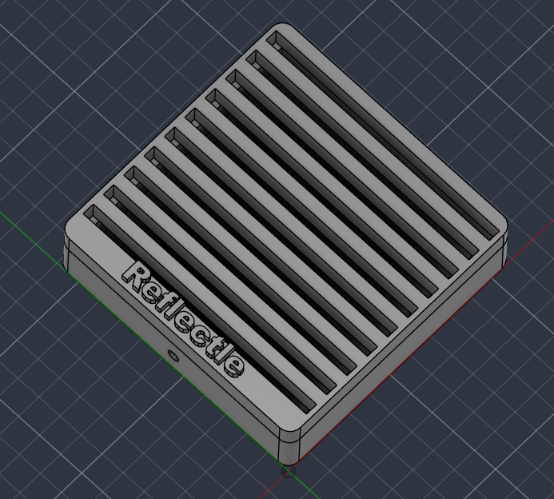

# Reflectle
A repository to contain my files for Week 4 of Hack Club's Half-Life! This project is going to use internal reflection to make a 3D looking display out of 2D lasecut acrylic slices.

I made the base that holds the acrylic slices in Fusion360. I originally wanted to lasercut the bottom part but I ended up using CAD because of some parts I needed to add.
At the basis of my design is an open box with a hole in the side for a USB power cable. On the inside, there are slots cut into two opposite walls for the acrylic to slot in to. There are also rails that extend across that will keep the acrylic sheets at a 90 degree angle. I also added some text with the project name across an area that was large and empty. The design is split into two parts that can be easily printed without supports.

The acrylic panels will slot into the insets and there will be 10 of them, measuring 106x90x4.5mm. There will be different designs on all of them, being layers of a 3D shape. Hopefully the effect will look good, at least at some angles.
