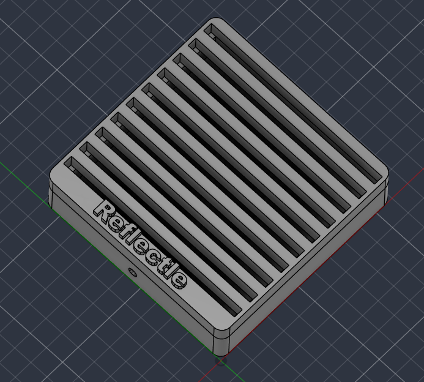
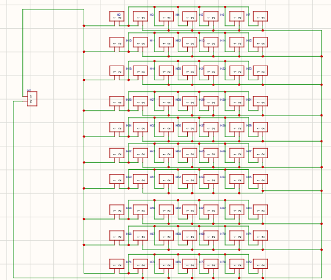
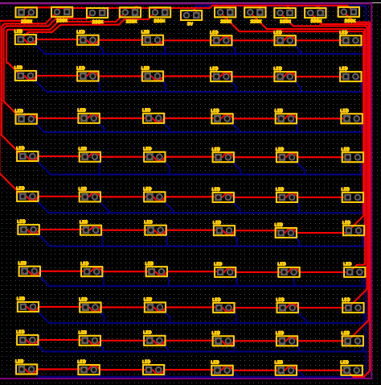
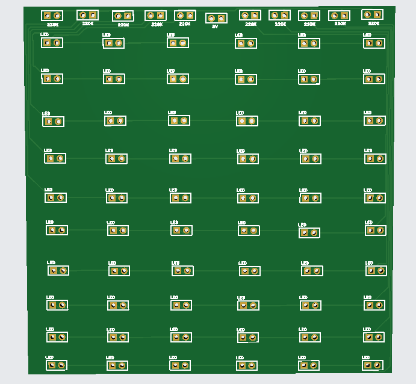
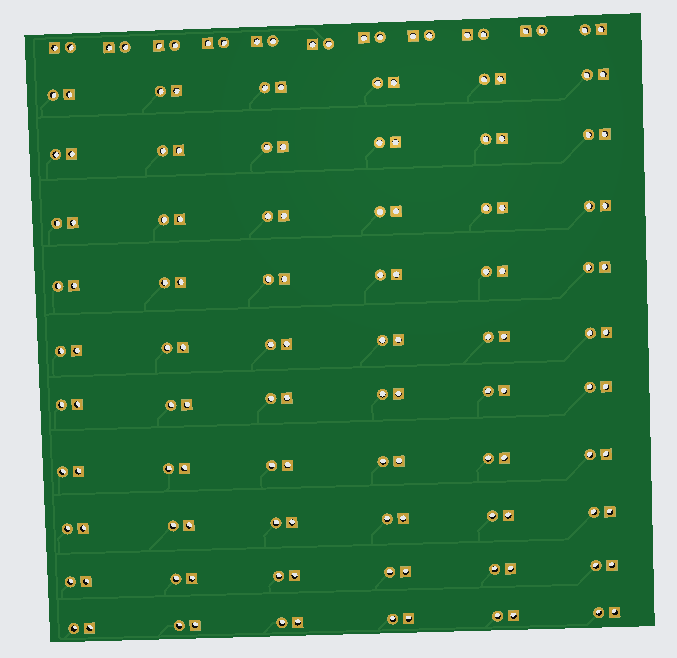
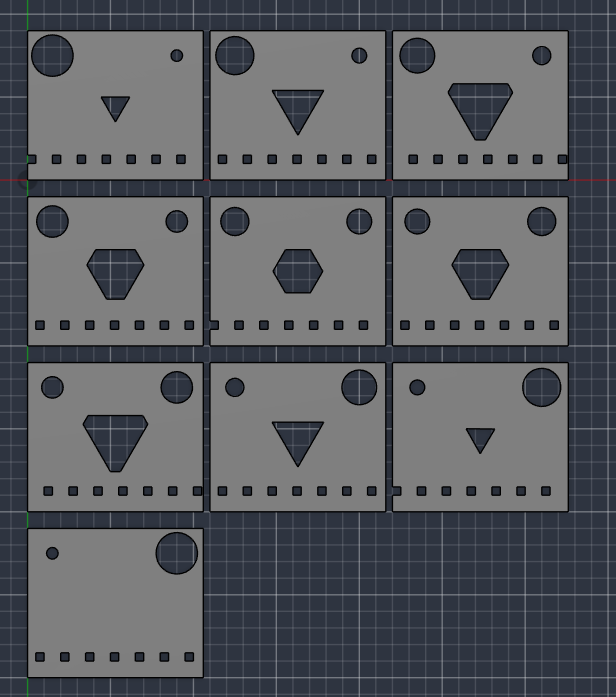

# Reflectle
A repository to contain my files for Week 4 of Hack Club's Half-Life! This project is going to use internal reflection to make a 3D looking display out of 2D lasecut acrylic slices. The design includes a base, acrylic slices, and a PCB housing the electronics. It will be powered by a USB cable that attaches to the PCB.

I made the base that holds the acrylic slices in Fusion360. I originally wanted to lasercut the bottom part but I ended up using CAD because of some parts I needed to add.
At the basis of my design is an open box with a hole in the side for a USB power cable. On the inside, there are slots cut into two opposite walls for the acrylic to slot in to. There are also rails that extend across that will keep the acrylic sheets at a 90 degree angle. I also added some text with the project name across an area that was large and empty. The design is split into two parts that can be easily printed without supports.

The acrylic panels will slot into the insets and there will be 10 of them, measuring 106x90x4.5mm. There will be different designs on all of them, being layers of a 3D shape. Hopefully the effect will look good, at least at some angles.

I designed a PCB to fit all of the parts. I did this because it would be much more accurate than trying to align 60 LEDs in the right place. I used EasyEDA Pro to make my designs and decided to track them manually. I had to think a lot about how I wanted to arrange the parts for a good, clean schematic.
Here is the final schematic for my PCB:

I think it was done optimally and looks pretty good.
I arranged the parts by comparing measurements against the CAD model. This is the PCB that is tracked up:

Here are both sides of the model that JLCPCB created when I ordered the PCB:

I designed the slices in Fusion360 because I know how to use it, it's accurate and easy to implement measurements, and it is free. There are a few different effects that I have included in them. There are:
- The different sized circles making cones.
- The shapes in the middle which should make up the outline of a cube.
- The square pattern at the bottom that should show them moving around.
Here is the image of the finished design after it was extruded. The cut out bits will be engraved when I get it lasercut.

